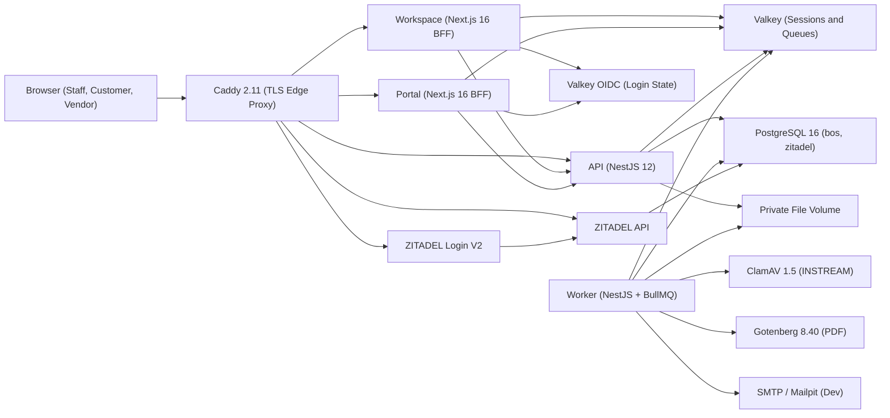

# Architecture

Business OS is a modular monolith built as a pnpm TypeScript monorepo. One NestJS codebase powers both the HTTP API and the background job worker, paired with two Next.js backend-for-frontend (BFF) web applications, PostgreSQL 16, Valkey, and ZITADEL for OpenID Connect (OIDC) authentication.

This layout keeps deployments simple for self-hosting on a single Linux server with Docker Compose while maintaining clear boundaries between business modules, tenant data, and background jobs.

## System overview

## Monorepo packages

| Package                | Name                | Role                                                                                                                                                           |
| ---------------------- | ------------------- | -------------------------------------------------------------------------------------------------------------------------------------------------------------- |
| `apps/api`             | `@bos/api`          | NestJS HTTP API (`src/main.ts`) and BullMQ worker (`src/worker.ts`) shipped in one image with two entry points                                                 |
| `apps/workspace`       | `@bos/workspace`    | Staff web application (Next.js App Router BFF)                                                                                                                 |
| `apps/portal`          | `@bos/portal`       | Customer and vendor portal (Next.js App Router BFF)                                                                                                            |
| `packages/contracts`   | `@bos/contracts`    | Shared Zod schemas, DTO types, permission keys, phone and address validators                                                                                   |
| `packages/db`          | `@bos/db`           | Drizzle ORM schema definitions, SQL migrations, tenancy checker, and audit checker                                                                             |
| `packages/locale`      | `@bos/locale`       | `decimal.js` money helpers, South Asian/international digit grouping, amount-in-words, Kathmandu time, Bikram Sambat dates, and Nepali fiscal years            |
| `packages/money-rules` | `@bos/money-rules`  | Pure, I/O-free domain arithmetic for pricing, VAT, discounts, FX conversion, allocations, three-way match, TDS withholding, approval bands, and delivery holds |
| `packages/pdf-viewer`  | `@bos/pdf-viewer`   | Shared `pdf.js` canvas renderer used by Workspace and Portal                                                                                                   |
| `tools/seed-zitadel`   | `@bos/seed-zitadel` | Idempotent CLI that provisions ZITADEL projects, roles, OIDC clients, organizations, and development personas                                                  |

External dependency versions are centralized in the `catalog:` section of `pnpm-workspace.yaml`, which also sets supply-chain controls (`minimumReleaseAge: 1440` and an explicit `allowBuilds` allowlist).

## Modular monolith and worker separation

The backend is organized into platform services (`apps/api/src/platform/*`) and business domain modules (`apps/api/src/modules/*`):

- **Platform modules**: `auth`, `authz`, `audit`, `config`, `db`, `documents`, `health`, `notify`, `obs`, `queue`, `settings`, `tenancy`, and `users`.
- **Domain modules**: `customers`, `leads`, `opportunities`, `activities`, `quotations`, `verification`, `sales-orders`, `invoices`, `payments`, `payment-proofs`, `receivables`, `ledger`, `vendors`, `procurement` (requests, sourcing, orders, receipts), `payables` (bills, bill submissions, payment requests), `approvals`, `access-settings`, `departments`, `company-accounts`, `party-imports`, `evidence`, `images`, `test-memo`, `portal`, `portal-billing`, `portal-vendor`, and `portal-access`.

`AppModule` (`apps/api/src/app.module.ts`) imports only HTTP modules and never runs BullMQ job processors. `WorkerModule` (`apps/api/src/worker.module.ts`) imports only `*WorkerModule` providers and has no HTTP controllers or user authentication routes. Background jobs cover:

- Antivirus scanning of uploaded files (`DocumentsWorkerModule`)
- Transactional email outbox draining (`NotifyWorkerModule`)
- Approval SLA reminders (`ApprovalsWorkerModule`)
- Gotenberg PDF rendering for quotations, invoices, and purchase orders
- Scheduled expiry jobs for quotations, vendor KYB cases, payment promises, and party imports
- Monthly audit chain sealing (`AuditWorkerModule`) and user/portal policy sync

## Identity, sessions, and authorization

### Identity provider (ZITADEL)

ZITADEL v4.20.1 (`zitadel-api`) handles user credentials, password policies, MFA (TOTP and passkeys), account lockout, and password recovery. A custom-styled ZITADEL Login V2 container (`infra/login`) renders the sign-in flow at `https://<AUTH_HOST>/ui/v2/login`.

In production (`infra/compose/compose.prod.yaml`), Caddy mounts `infra/caddy/auth-restricted.caddy` so the public auth host accepts only OIDC sign-in paths and blocks the ZITADEL admin console and management APIs.

### BFF session architecture

Both `apps/workspace` and `apps/portal` run as OIDC confidential/PKCE clients using `openid-client`:

- OIDC login state (`state`, `nonce`, PKCE verifier) lives in a dedicated `valkey-oidc` container capped at 32 MiB with `volatile-ttl` and no disk persistence, preventing login floods from filling the main queue and session store.
- Authenticated sessions are stored encrypted in the primary `valkey` instance (`noeviction`, AOF enabled). Workspace uses `SESSION_ENC_KEY` (key ID `k1`) and Portal uses `PORTAL_SESSION_ENC_KEY` (key ID `p1`), so a portal session can never be read as a staff session.
- The browser never handles raw API bearer tokens directly in client storage. Server routes and Server Actions attach credentials when calling `API_INTERNAL_URL`.

### API authorization and route policy

On startup, `apps/api/src/main.ts` runs `assertRoutePolicy(app)` and refuses to boot if any controller route is missing an explicit `@Can(...)`, `@AnyAuthenticated()`, or `@Public()` decorator.

At request time, `AuthModule` validates ZITADEL JWTs using `jose`, and `AuthzModule` enforces:

1. **Role permissions**: Live grants stored per tenant in `app.role_permissions`, initialized from `DEFAULT_ROLE_PERMISSIONS` in `packages/contracts/src/authz.ts`.
2. **Department levels and record scopes**: Memberships carry a level (`staff`, `manager`, `head`) and scopes (`assigned`, `own`, `department`, `customer_org`, `all`).
3. **Separation of duties**: Creators, requesters, and preparers cannot approve their own work, and maker-checker operations (such as payment verification, invoice issuance, and vendor bank verification) reject the same actor on both sides.

### Development-only boundary

Development helpers (such as the floating Dev menu and local account switcher in `apps/workspace`) are gated by build profile (`BOS_BUILD_PROFILE`) and stripped from production builds. `apps/workspace/scripts/check-no-dev-routes.mjs` verifies that production Workspace builds, Portal builds, and the built Workspace Docker image contain no `/dev/` routes or dev-tool markers. Both `tools/gate.sh` and GitHub Actions CI run this check.

## Data model, tenancy, and audit

### PostgreSQL cluster and roles

One PostgreSQL 16 instance hosts two databases: `bos` (application data) and `zitadel` (identity provider state). Database privileges are split between two application roles:

- `bos_owner`: Owns the `bos` database and runs Drizzle SQL migrations (`DATABASE_MIGRATE_URL`).
- `bos_app`: Runtime role used by the API and worker (`DATABASE_URL`), with restricted privileges and append-only access to audit events.

### Tenancy and counterparty invariants

Schema conventions in `packages/db` are enforced automatically by `packages/db/dist/check-tenancy.js`:

- Entity-owned tables in schema `app` carry `tenant_id uuid NOT NULL` and `organization_id uuid NOT NULL` (where `organization_id` represents the legal entity).
- Tenant-wide tables carry `tenant_id uuid NOT NULL` with foreign keys to `app.tenants`.
- Customer and vendor links use nullable `customer_party_id` or `vendor_party_id` columns referencing `app.parties`, with tenant-leading indexes so portal queries stay scoped to the caller's party.

Sensitive vendor bank account fields are encrypted before storage using the `FIELD_ENC_KEYS` keyring.

### Tamper-evident audit chain

Every business table in schema `app` (with four explicit infrastructure exemptions: `tenants`, `notifications`, `outbox`, and `authz_versions`) must attach the `audit_capture` database trigger (`audit.capture_row()`). `packages/db/dist/check-audit.js` fails builds if a table omits this trigger.

Audit events are written to `audit.audit_events` with actor identity, action, entity type and ID, canonical `before`, `after`, and `meta` JSON text, IP address, user agent, correlation ID, and a SHA-256 hash linked to the previous row in the same UTC month. `GET /v1/audit/verify?month=YYYY-MM` recomputes the chain to confirm no row was altered or removed.

### Backups

`infra/compose/compose.yaml` runs `backup-scheduler` alongside PostgreSQL using `pgBackRest` with AES-256 repository encryption (`PGBACKREST_REPO1_CIPHER_PASS`). `pnpm drill` executes `infra/backup/restore-drill.sh` against an isolated `pgdata-drill` volume to verify restores. Uploaded documents in the `files` volume are backed up separately with `restic` (`infra/backup/files-backup.sh`).

## Money and Nepal locale layer

All monetary calculations avoid JavaScript floating-point numbers:

- `@bos/locale` uses `decimal.js` configured with 34 significant digits and `ROUND_HALF_UP` rounding. Monetary values are stored as `numeric(18,2)` in PostgreSQL and passed across API boundaries as decimal strings.
- `@bos/money-rules` contains pure functions for line pricing, per-bucket VAT calculation, largest-remainder allocation (assigning split remainders to the final line), FX conversion to NPR, three-way bill matching, TDS withholding, and approval threshold checks.
- Calendar dates in `@bos/locale` normalize instants to `Asia/Kathmandu` (UTC+05:45, no daylight saving) before converting to Bikram Sambat via `nepali-date-converter` and computing Shrawan-to-Asar Nepali fiscal years (`2082/83`).

## Documents, antivirus scanning, and PDF rendering

Uploaded files follow a quarantine pipeline:

1. Uploads are capped at 25 MiB (`MAX_UPLOAD_BYTES`) and restricted to an explicit MIME allowlist (PDF, PNG, JPEG, WebP, DOCX, XLSX, PPTX, CSV).
2. The API writes the file to quarantine storage under `FILES_ROOT`, verifies its magic bytes with `file-type`, computes its SHA-256 hash, and enqueues a scan job.
3. The worker streams the file to `clamav` (`clamd` over TCP `INSTREAM`). Only files marked `clean` can be downloaded. Infected or rejected files stay blocked.
4. Authorized downloads receive a 60-second, single-use signed URL backed by `DOCS_LINK_SECRET`.

Generated PDFs for quotations, invoices, and purchase orders are rendered by the worker via **Gotenberg** (headless Chromium). Gotenberg sits on the internal `backend` Docker network with no outbound internet route, so templates embed inline CSS and self-contained assets and rely on the image's bundled Noto Devanagari fonts. Internal memo exports use `pdfkit`.

## Mail and notifications

Business events write in-app notifications and email rows into a transactional outbox table inside the same PostgreSQL transaction as the domain write. The BullMQ worker drains the outbox through `SmtpEmailProvider` (`nodemailer`), redacting SMTP credentials from any recorded error message and logging status transitions (`queued`, `sending`, `delivered`, `failed`, `bounced`) for the email delivery log.

In development, outbound email goes to Mailpit (`https://mail.localhost`). In production, operators point `SMTP_URL` at their SMTP relay or Postal instance and configure `POSTAL_WEBHOOK_SECRET` so signed bounce notifications to `POST /v1/hooks/postal` (`x-postal-signature` HMAC-SHA256) automatically mark bounced addresses.

## Edge routing and observability

- **Caddy** handles TLS termination (`tls internal` in dev or Let's Encrypt in production), sets `X-Request-Id` on API calls, uses short upstream keepalives (`3s`) with one retry on dropped idle connections, and returns `404` for `/metrics` on public hosts.
- **Logging and metrics**: Both the API and worker emit structured JSON logs via `pino` with request correlation IDs and expose Prometheus metrics (`prom-client`) on internal-only ports (`9464` for API, `9465` for worker). The optional `obs` Compose profile starts Prometheus to scrape both targets.
